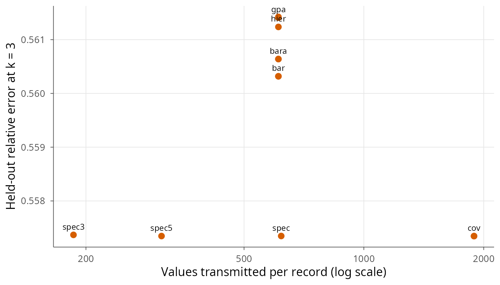
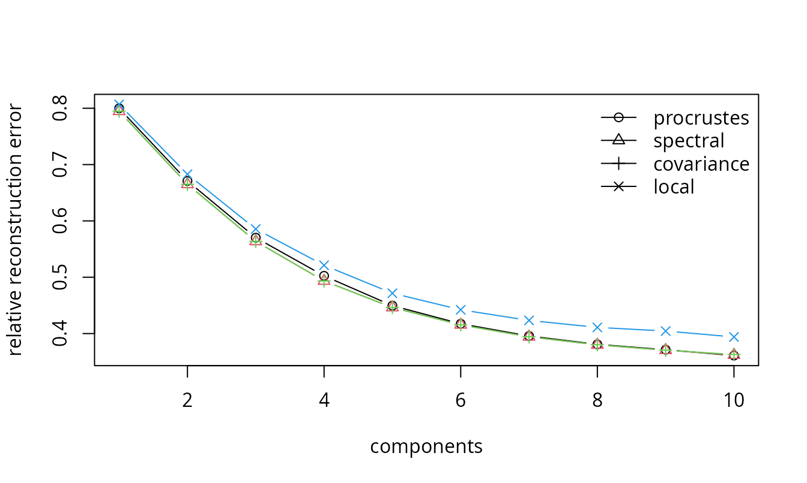

# Getting started with beatpool

`beatpool` pools patient-specific principal component bases of ECG
heartbeats without sharing the raw signals. Each site sends a small
summary, either a `p x q` basis or a set of leading eigenpairs, and the
server assembles a common representation. This vignette walks through
the main functions on simulated data that mimic the heterogeneity of
real recordings.

## Simulating heterogeneous records

``` r
library(beatpool)

sim <- simulate_beats(H = 8, n = 200, p = 61, q = 10,
                      model = "heterogeneous", epsilon = 0.2,
                      sigma = 0.15, seed = 1)
str(sim$X[[1]])
#>  num [1:200, 1:61] 0.0736 0.0262 0.297 0.1357 -0.0229 ...
#>  - attr(*, "record")= chr "sim1"
#>  - attr(*, "labels")= chr [1:200] "normal" "normal" "normal" "normal" ...
#>  - attr(*, "normal")= logi [1:200] TRUE TRUE TRUE TRUE TRUE TRUE ...
```

The records share a common eigenbasis `Q0` but each one is rotated by an
orthogonal matrix. The rotation is the source of the federation problem:
the individual bases are not comparable entry by entry.

## Patient bases

``` r
bases <- extract_bases(sim$X, q = 10)
bases[[1]]
#> beatpool PCA basis
#>   data: 200 beats x 61 samples | components: 10 
#>   explained variance (first 3): 1.05, 0.5776, 0.4314
round(crossprod(bases[[1]]$T), 3)[1:4, 1:4]
#>      [,1] [,2] [,3] [,4]
#> [1,]    1    0    0    0
#> [2,]    0    1    0    0
#> [3,]    0    0    1    0
#> [4,]    0    0    0    1
```

[`extract_bases()`](https://raydonal.github.io/beatpool/reference/extract_bases.md)
returns one `bp_basis` object per record. The columns are orthonormal,
but their signs, order and orientation are arbitrary.

## Pooling

Four pooling operators are available. The orthogonal Procrustes mean is
the default and minimises the average squared Frobenius distance to the
inputs.

``` r
p_proc <- pool_bases(bases, method = "procrustes")
p_bar  <- pool_bases(bases, method = "bar")
p_qr   <- pool_bases(bases, method = "qr")
p_proc
#> beatpool pooled basis
#>   method: procrustes | aligned: TRUE | bases: 8 | components: 10
```

Pooling second moments is an alternative that requires no alignment at
all. The assembled covariance

\\ \hat\Sigma = \sum_h w_h Q_h \Lambda_h Q_h' \\

is invariant to any orthogonal transformation of \\Q_h\\, because the
outer product absorbs it.

``` r
p_spec <- pool_spectral(bases, q = 10, q_out = 10)
p_cov  <- pool_covariance(sim$X, q = 10)
p_spec
#> $T
#>                [,1]          [,2]          [,3]          [,4]          [,5]
#>  [1,]  5.211336e-03 -0.0106048839  0.0147584885  0.0055988519  0.0092742926
#>  [2,]  9.265645e-03  0.0098700537 -0.0098198609 -0.0161568471  0.0193731781
#>  [3,]  1.571986e-02  0.0063814627 -0.0063994584 -0.0081384887  0.0141543007
#>  [4,]  2.448618e-03  0.0102266514  0.0110892030 -0.0105648806 -0.0094135335
#>  [5,]  1.310069e-03 -0.0136820903  0.0070194405 -0.0234536834  0.0119085753
#>  [6,] -7.753977e-03 -0.0021653865 -0.0046233441 -0.0167017009 -0.0101388737
#>  [7,]  6.187955e-03 -0.0208396338 -0.0030569228 -0.0080185019  0.0067363665
#>  [8,]  5.962291e-03 -0.0080215559  0.0057910802 -0.0151268308  0.0079420764
#>  [9,]  1.003473e-03  0.0204783580  0.0069890786 -0.0163129104  0.0008715301
#> [10,] -4.639605e-03  0.0111658783 -0.0141101227  0.0143383472  0.0040242347
#> [11,]  1.610637e-02  0.0158971829  0.0257064939  0.0086449083  0.0051467721
#> [12,] -2.724982e-03 -0.0122374054  0.0236104973 -0.0034055661  0.0018262061
#> [13,] -1.394161e-03 -0.0075799300  0.0080624816  0.0018916197  0.0317775560
#> [14,]  9.636509e-03  0.0054042805  0.0188473269  0.0021654126 -0.0005869971
#> [15,] -1.755087e-02 -0.0079401022  0.0046241557 -0.0072487089 -0.0078146021
#> [16,] -6.187311e-03  0.0244076139 -0.0065563198 -0.0197152917  0.0276051694
#> [17,]  1.923440e-02  0.0076499363  0.0006805536 -0.0171442454  0.0101541525
#> [18,]  1.482736e-02  0.0140284049 -0.0066579250 -0.0096150138 -0.0077282930
#> [19,] -1.404050e-02 -0.0108441686  0.0324539548 -0.0046898803  0.0439888705
#> [20,] -1.347651e-02  0.0080241895  0.0130025554 -0.0099822340  0.0611236492
#> [21,] -7.319875e-05  0.0105905357  0.0441371103 -0.0829455540  0.1572202493
#> [22,]  9.914217e-03  0.0207033903  0.0969538449 -0.1153444507  0.2540565178
#> [23,]  6.882557e-03  0.0633282436  0.1782870853 -0.2270207771  0.3230451466
#> [24,]  3.263073e-03  0.0819185668  0.2491129313 -0.3012958408  0.3314658768
#> [25,]  5.719132e-02  0.1792832528  0.3238143606 -0.3132185060  0.2012075269
#> [26,]  9.779389e-02  0.2784534429  0.3340365915 -0.2119583043 -0.0511793262
#> [27,]  1.694673e-01  0.3518452865  0.2798012621 -0.0408950685 -0.2328741088
#> [28,]  2.611921e-01  0.3893625659  0.1508188027  0.1767370974 -0.2343794801
#> [29,]  3.231535e-01  0.3266285437 -0.0402817639  0.3031571934 -0.0679736443
#> [30,]  3.854167e-01  0.2118432838 -0.2126915145  0.1999101592  0.2015480574
#> [31,]  3.998709e-01  0.0185904658 -0.2892105651 -0.0132917440  0.3008816888
#> [32,]  4.133030e-01 -0.1600812102 -0.2340302063 -0.1984400070  0.1585428018
#> [33,]  3.782107e-01 -0.2933949443 -0.0469112495 -0.2901933317 -0.0906846550
#> [34,]  2.952418e-01 -0.3287957572  0.1449463995 -0.1568693920 -0.2829368762
#> [35,]  2.145370e-01 -0.3165571902  0.3069282715  0.0308287631 -0.2466059535
#> [36,]  1.464468e-01 -0.2448027683  0.3482489981  0.2247481402 -0.0244606077
#> [37,]  6.292783e-02 -0.1949038644  0.2826948316  0.3447887961  0.1943486774
#> [38,]  3.455356e-02 -0.1397848942  0.2031921444  0.3164174935  0.2871183349
#> [39,]  2.705042e-03 -0.0790564813  0.1431197538  0.2583193831  0.2404439769
#> [40,] -2.952220e-03 -0.0474901336  0.0668410228  0.1660016167  0.1750552998
#> [41,] -6.258786e-03 -0.0165774767  0.0247940824  0.1050170217  0.0913512751
#> [42,] -1.664012e-03 -0.0114534711  0.0242491151  0.0301913114  0.0399830596
#> [43,] -6.744158e-03 -0.0070566083  0.0001882159  0.0143287557 -0.0181498006
#> [44,]  4.886162e-05  0.0171487150 -0.0154377542  0.0046807427 -0.0046431295
#> [45,] -1.438021e-02 -0.0072736611  0.0044508939 -0.0120175290 -0.0026702780
#> [46,]  4.248891e-03 -0.0045860783  0.0199852548  0.0008634742 -0.0196460320
#> [47,]  1.211529e-02 -0.0107920795 -0.0008460840  0.0009463702 -0.0131825410
#> [48,]  1.844473e-05 -0.0092581688  0.0044890875 -0.0076269920  0.0149630368
#> [49,] -6.278536e-03  0.0027948805  0.0093126482  0.0087478532  0.0086254583
#> [50,]  7.838780e-03 -0.0153189717  0.0100231880 -0.0134114646  0.0518657475
#> [51,]  1.764061e-03 -0.0263159680  0.0036785129  0.0003301591  0.0058173121
#> [52,]  2.241937e-03  0.0003742467 -0.0009040822  0.0064032848  0.0173872308
#> [53,]  3.149657e-03  0.0037429647  0.0043778669 -0.0016334786 -0.0252363929
#> [54,]  5.952981e-04  0.0024628220  0.0156408053  0.0061537931  0.0049960438
#> [55,]  1.428229e-02 -0.0127905009 -0.0199047889 -0.0109549187 -0.0181554755
#> [56,]  8.168047e-03 -0.0016382350  0.0107920767  0.0178604569  0.0081597472
#> [57,] -4.659926e-03 -0.0129238369  0.0165366885  0.0081190675  0.0178677385
#> [58,]  1.281244e-02  0.0070621523  0.0002223923  0.0111170454 -0.0040219498
#> [59,]  1.132528e-02  0.0150578391 -0.0058214183  0.0042245874  0.0172973925
#> [60,] -7.393876e-03  0.0006252187 -0.0153360138  0.0088470301  0.0026568111
#> [61,]  1.029558e-02  0.0015592937  0.0023664249  0.0049800991  0.0165770546
#>                [,6]          [,7]          [,8]         [,9]        [,10]
#>  [1,]  0.0173498802  0.0057064124  0.0188858596  0.057096321  0.167513983
#>  [2,] -0.0046166620  0.0005692385  0.0244527150  0.016198991  0.021127073
#>  [3,] -0.0084588577 -0.0201708667 -0.0313826093 -0.073891387  0.009878611
#>  [4,] -0.0205605061 -0.0021177009 -0.0031132152  0.024232471  0.120997122
#>  [5,]  0.0096359243 -0.0180944583  0.0103978906 -0.010626764  0.061913246
#>  [6,]  0.0097677189  0.0167365458 -0.0264367510 -0.096908497  0.017836207
#>  [7,] -0.0180307697 -0.0219553920  0.0235572165  0.030014320 -0.026360957
#>  [8,] -0.0006599865 -0.0081453495  0.0025536467 -0.004610821 -0.063461506
#>  [9,] -0.0078828965 -0.0074878778 -0.0431686333 -0.034341348  0.042534496
#> [10,]  0.0022196949 -0.0258022585 -0.0318066300  0.022246343 -0.018649908
#> [11,] -0.0076454780  0.0016269620 -0.0307971940 -0.018525187  0.021814931
#> [12,]  0.0046092834 -0.0133321741 -0.0105439701  0.008659707 -0.175267646
#> [13,] -0.0170528582  0.0086673633  0.0653591915  0.027727774  0.111138748
#> [14,] -0.0122795769 -0.0239527368 -0.0449082276  0.097671932  0.013137358
#> [15,]  0.0165526741 -0.0124491923 -0.0372630165  0.023417237 -0.215946397
#> [16,]  0.0215211958  0.0466710814  0.0006982472  0.037335798 -0.178331005
#> [17,] -0.0521961504  0.0422074804 -0.0625230178  0.184028915 -0.164608918
#> [18,] -0.0376017639  0.0292853703 -0.0927236544  0.188647928 -0.162742198
#> [19,] -0.0871683370  0.1646502890 -0.2314840345  0.339025832 -0.180739833
#> [20,] -0.1445666847  0.2313100167 -0.2893035111  0.260486984 -0.234174088
#> [21,] -0.2693960829  0.3160771505 -0.2988434863  0.098718102  0.021603243
#> [22,] -0.2931263716  0.2672997404 -0.1452287203  0.012651378  0.238519681
#> [23,] -0.2934303384  0.1539923227  0.0497428910 -0.295428072  0.077780043
#> [24,] -0.1192989715 -0.0973249587  0.2931085731 -0.134918776 -0.120007637
#> [25,]  0.1273935959 -0.1997532973  0.1547186842  0.117883057 -0.127627240
#> [26,]  0.3117204639 -0.1540893073 -0.0898263581  0.222815072 -0.029436161
#> [27,]  0.2042537423  0.0796321566 -0.2290699028  0.005734031  0.161812004
#> [28,] -0.0298514587  0.2054203987 -0.1244397886 -0.166186632  0.080252783
#> [29,] -0.2431324651  0.0886659982  0.2169965806 -0.157293594 -0.102399180
#> [30,] -0.1859842424 -0.1205919100  0.1757303069  0.083165465 -0.153786551
#> [31,]  0.0572444455 -0.1985234933 -0.0341356443  0.251018545  0.019343737
#> [32,]  0.2196591926 -0.0263359206 -0.1682444427 -0.020840682  0.186759486
#> [33,]  0.1723401690  0.1864004820 -0.1237072369 -0.189849471  0.021331543
#> [34,] -0.0345617975  0.1899497902  0.1368176309 -0.083945123 -0.208333483
#> [35,] -0.2615540592 -0.0184518449  0.2201716363  0.073313766 -0.029492129
#> [36,] -0.1856128133 -0.2364815545 -0.0249766554  0.270335796  0.090744040
#> [37,] -0.0153930625 -0.2166481577 -0.2007731314 -0.017891030  0.127070988
#> [38,]  0.1978910828 -0.0385290806 -0.1875702303 -0.172601241  0.055576238
#> [39,]  0.2945534971  0.1981399285  0.0113498185 -0.230673246 -0.166168429
#> [40,]  0.2965763572  0.3550105556  0.1697115858  0.064921498 -0.241114410
#> [41,]  0.2064162854  0.3158034784  0.2851445084  0.199833979  0.032621827
#> [42,]  0.1007046348  0.2123475934  0.3105603557  0.280800154  0.254956867
#> [43,]  0.0212569107  0.1546015397  0.1962525222  0.194942517  0.290675481
#> [44,] -0.0009695496  0.0881546589  0.0965581280  0.139994848  0.267902818
#> [45,] -0.0066357073  0.0255521640  0.0460640039  0.061688798  0.081532546
#> [46,]  0.0250675196 -0.0053497160  0.0073807345  0.039546249 -0.026883932
#> [47,] -0.0067137365  0.0032400971 -0.0175302328 -0.021991023  0.001692958
#> [48,]  0.0283758692  0.0654206017  0.0062112503  0.039119980 -0.029193019
#> [49,] -0.0203334562  0.0054904194  0.0150684550  0.052907715  0.157288558
#> [50,]  0.0127748993  0.0234258055  0.0429588688 -0.054782707  0.129962554
#> [51,]  0.0158333605  0.0068295662 -0.0137430216 -0.055033025 -0.099520972
#> [52,]  0.0174291461 -0.0242758837 -0.0087347265 -0.045528022  0.095183299
#> [53,] -0.0139848925 -0.0390769210 -0.0291795508 -0.011761185 -0.096767250
#> [54,]  0.0025905539 -0.0062946308  0.0390156423 -0.021075519  0.021735197
#> [55,]  0.0043742933 -0.0460046390 -0.0073062225  0.016390067 -0.052738176
#> [56,]  0.0106332422  0.0327275569  0.0151063972 -0.019046147  0.092958982
#> [57,]  0.0022753759  0.0027654458 -0.0532330799 -0.026306846  0.017663946
#> [58,]  0.0062588875 -0.0038317180 -0.0186517056  0.004377384  0.045748166
#> [59,]  0.0223665474  0.0333271193 -0.0543146053 -0.058865180  0.013149159
#> [60,]  0.0047041557  0.0221938638  0.0014066471 -0.028039668  0.106490228
#> [61,] -0.0021262940  0.0465210091 -0.0479912347 -0.042478356  0.035113131
#> 
#> $values
#>  [1] 0.97173658 0.65669337 0.38521727 0.23710755 0.16063494 0.10621970
#>  [7] 0.07299344 0.04816379 0.02848586 0.01588295
#> 
#> $mean
#>  [1] 0 0 0 0 0 0 0 0 0 0 0 0 0 0 0 0 0 0 0 0 0 0 0 0 0 0 0 0 0 0 0 0 0 0 0 0 0 0
#> [39] 0 0 0 0 0 0 0 0 0 0 0 0 0 0 0 0 0 0 0 0 0 0 0
#> 
#> $q
#> [1] 10
#> 
#> $n
#> [1] 8
#> 
#> $p
#> [1] 61
#> 
#> $method
#> [1] "spectral"
```

## Comparing every operator

[`pool_all()`](https://raydonal.github.io/beatpool/reference/pool_all.md)
runs the operator families on the same bases and records the
communication cost of each one. The spectral summary transmits
`q * (p + 1)` numbers, the basis operators `p * q`, and the covariance
`p * (p + 1) / 2`.

``` r
all <- pool_all(sim$X, q = 10)
attr(all, "numbers")
#>   bar  bara   cov  covn   gpa  hier  proc    qr   qra  spec spec3 spec5 
#>   610   610  1891  1891   610   610   610   610   610   620   186   310
```

The cost–error plane can be drawn directly from the collection.

``` r
err <- vapply(all, function(T) mean(vapply(sim$X, reconstruction_error,
  numeric(1), T = T, k = 3)), numeric(1))
plot_cost_error(all, err, k = 3)
```



## Reconstruction on held-out beats

``` r
X_new <- simulate_beats(H = 1, n = 200, p = 61, q = 10,
                        model = "heterogeneous", epsilon = 0.2,
                        sigma = 0.15, seed = 99)$X[[1]]

ks <- 1:10
err <- data.frame(
  k = ks,
  procrustes = vapply(ks, function(k)
    reconstruction_error(X_new, p_proc$T, k), numeric(1)),
  spectral = vapply(ks, function(k)
    reconstruction_error(X_new, p_spec$T, k), numeric(1)),
  covariance = vapply(ks, function(k)
    reconstruction_error(X_new, p_cov$T, k), numeric(1)),
  local = vapply(ks, function(k)
    reconstruction_error(X_new, bases[[1]]$T, k), numeric(1))
)

matplot(err$k, err[, -1], type = "b", pch = 1:4, lty = 1,
        xlab = "components", ylab = "relative reconstruction error")
legend("topright", names(err)[-1], pch = 1:4, lty = 1, bty = "n")
```



The local basis is an oracle: it is fitted on the same recording. The
pooled bases should approach it as the number of records grows.

## Downstream clustering

``` r
mix <- simulate_beats(H = 1, n = 400, p = 61, q = 10, model = "mixture",
                      mu = 1.5, sigma = 0.2, seed = 2)
X <- mix$X[[1]]
cl <- cluster_beats(X, p_proc$T, k = 5, K = 2, truth = mix$labels[[1]],
                    seed = 1)
cl$metrics
#>   prop_correct      ari purity
#> 1        0.915 0.688119  0.915
```

## Rate and distortion

The pooled operator is meant to be transmitted, so the basis is only
useful if its coefficients can be stored in few bits.
[`rate_distortion()`](https://raydonal.github.io/beatpool/reference/rate_distortion.md)
quantises each coefficient with a uniform scalar quantiser,
entropy-codes the integer levels and charges the basis and the mean once
per record, amortised over its beats.

``` r
rd <- rate_distortion(X_new, p_spec$T, k = 10,
                      steps = 2^seq(0, -6, by = -1))
rd[, c("step", "rate", "distortion", "compression_ratio")]
#>       step      rate distortion compression_ratio
#> 1 1.000000  75.30185   43.32129          8.910804
#> 2 0.500000  84.68070   37.95012          7.923883
#> 3 0.250000  94.13853   36.61105          7.127793
#> 4 0.125000 103.13306   36.30428          6.506158
#> 5 0.062500 111.31520   36.22296          6.027928
#> 6 0.031250 118.53183   36.20211          5.660927
#> 7 0.015625 123.64793   36.19703          5.426698
plot(rd$rate, rd$distortion, type = "b", pch = 19,
     xlab = "bits per beat", ylab = "mean relative error (%)")
```


The compression ratio is taken against the raw signal at 11 bits per
sample. Pass `transmit_basis = FALSE` for a fixed transform such as the
DCT, which the decoder already knows, and `n_amortize` to change the
number of beats over which the basis is amortised.

## Reading WFDB files

The package contains a pure-R reader for MIT-BIH style records, so the
whole pipeline can run without external WFDB software.

``` r
x <- read_wfdb("100", dir = "data/mitdb")
ann <- read_annotations("data/mitdb/atr/100.atr")
X <- prepare_record(x$MLII, ann, record = "100", fs = 360, wsize = 30)
b <- pca_basis(X, q = 10)
```

## Stability

Jackknife stability measures how much the pooled basis changes when one
recording is removed.

``` r
loo <- leave_one_out_pool(bases)
jackknife_stability(loo)
#>   record  relative  subspace
#> 1      1 0.9716123 0.3339151
#> 2      2 0.1147934 0.1129390
#> 3      3 0.1130315 0.1112893
#> 4      4 0.1165928 0.1139043
#> 5      5 0.1098670 0.1083451
#> 6      6 0.1155400 0.1134648
#> 7      7 0.1182198 0.1169588
#> 8      8 0.1163175 0.1139492
```

## Several shared bases

When records differ, a single basis leaves structure unused. Each record
can transmit the eigenpairs of its energy-normalised moment, and the
receiver can group them into a few shared bases without asking the
records for anything else. A record then compresses with the basis of
lowest error and sends its index.

``` r
sim <- simulate_beats(H = 12, n = 100, p = 30, q = 3, epsilon = 0.5, seed = 7)
moments <- lapply(sim$X, energy_moment, q = 6)
fit <- pool_shared(moments, k = 3, C = 3, seed = 1)
fit
#> <bp_shared> 3 bases of dimension 3, group sizes 4/4/4
select_shared(fit, sim$X[[1]])
#> [1] 1
#> attr(,"errors")
#> [1] 0.5575332 0.6546102 0.6381575
```
